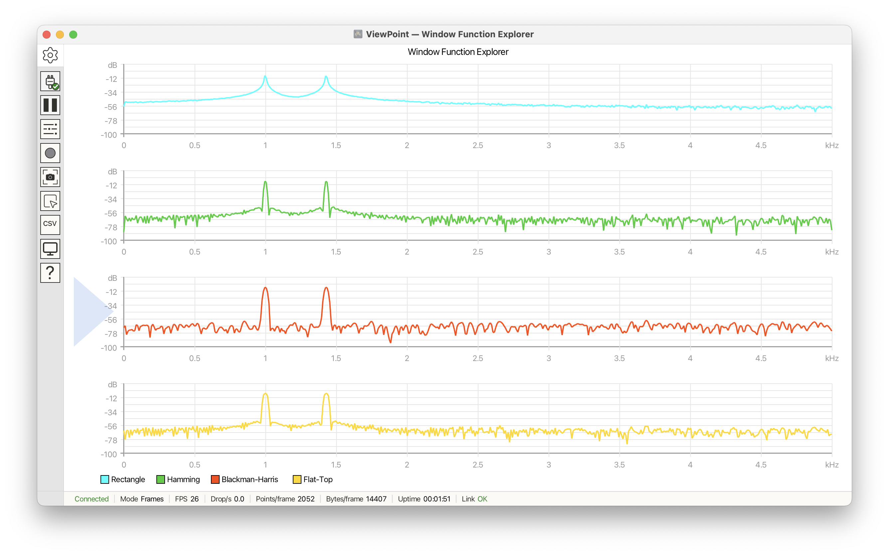

# SignalCore

SignalCore is a cross-platform digital signal processing toolkit for Arduino.
It gives a sketch the building blocks for working with signals: an FFT for
frequency analysis, software signal generation (direct digital synthesis, or
DDS), window functions, edge triggering, per-bin peak-hold, and exponential
moving average. Every part is header-only and lives under a single `signalcore`
namespace.

On a Teensy 4.x the FFT runs on CMSIS-DSP, ARM's hardware-accelerated math
library, with no setup on your part. On every other Arduino-compatible board it
uses a portable C++ implementation instead. Both produce the same spectrum so a sketch should move between boards without any change to its
signal-processing code.

SignalCore does the computation and does not depend on any particular display.
It pairs naturally with the [VoidLoop ViewPoint](https://docs.voidloop.com/viewpoint/)
serial plotter, for instance by feeding an FFT magnitude buffer into a
Frames-mode plot, but it works in any sketch that needs to analyze or generate
a signal.

## What you can do with it

| What you want to do | What to reach for |
|---|---|
| Perform an **FFT**, find peaks | The **FFT** transform with `peakBin()` and `peakFrequency()` |
| Change the FFT length at run time (a resolution control in a UI) | The runtime-sized **DynamicFFT** |
| Measure signal quality (SINAD, ENOB) | **FFT** metrics read off the magnitude spectrum |
| Generate a test tone, sweep, or modulate a signal in software | The **DDS** signal generator |
| Reduce spectral leakage before a transform | **Window** functions |
| Stabilize a repeating waveform | The **Trigger** module |
| Transform, filter, or smooth a dataset | **PeakHoldProcessor**, **ExponentialMovingAverage** |

## Install

### Arduino Library Manager

In the Arduino IDE, open **Tools → Manage Libraries…**, search for
**SignalCore**, and click **Install**.

### PlatformIO

Add the dependency to `platformio.ini`:

```ini
lib_deps =
    SignalCore
```

### Manual

Clone or download the repository into the Arduino libraries directory:

```bash
cd ~/Documents/Arduino/libraries
git clone https://github.com/voidloopers/SignalCore.git
```

The libraries folder is found within the Arduino `sketchbook` folder, whose
location can be found within the `Settings` dialog. Click `Arduino IDE →
Settings` and look for the `Sketchbook location` text box. The `libraries`
folder is not necessarily auto created — if it does not yet exist, simply
create the folder and copy SignalCore into it.

**Restart the Arduino IDE** so it picks up the new library.

Confirm the install by opening the **SignalGeneratorBasic** example (**File → Examples
→ SignalCore → SignalGeneratorBasic**) and uploading it to a board.


## Quick start

Every sketch starts with the same two lines. Include the umbrella header to pull
in every module, then bring the namespace into scope so you can write `FFT<>`
instead of `signalcore::FFT<>`:

```cpp
#include <SignalCore.h>
using namespace signalcore;
```

### Hello SignalCore

The smallest useful sketch generates a tone in software and prints it one sample
per line, so the Arduino **Serial Plotter** draws it directly. No analog hardware
is needed, which makes this a good first check that the library compiles and runs
on your board.

```cpp
#include <SignalCore.h>
using namespace signalcore;

#define SAMPLE_RATE 10000          // virtual samples per second

SignalGenerator sig(SAMPLE_RATE);

void setup() {
    Serial.begin(115200);
    sig.setCarrier(SignalShape::Sine, 200.0);   // 200 Hz tone
}

void loop() {
    Serial.println((float)sig.nextSample(0), 4);   // 0 = full-resolution float
    delayMicroseconds(1000000UL / SAMPLE_RATE);    // pace for the plotter
}
```

Upload it, then open **Tools → Serial Plotter** at 115200 baud. A clean 200 Hz
sine wave should scroll across the window.

### A first FFT

The next step generates a tone, runs an FFT over it, and reports the peak bin.
The transform length is set once, as a single number, and that same number sizes
the sample buffer too. There is only one value to change when you want a
different length, and the template and the buffer cannot drift apart:

```cpp
#include <SignalCore.h>
using namespace signalcore;

#define SAMPLE_RATE 10000
#define FFT_LENGTH  1024           // power of two, 32 up to 4096

FFT<FFT_LENGTH> fft;               // the transform, sized at compile time
SignalGenerator sig(SAMPLE_RATE);
float           samples[FFT_LENGTH];

void setup() {
    Serial.begin(115200);
    sig.setCarrier(SignalShape::Sine, 1000.0);          // 1 kHz tone
    fft.setWindowType(WindowType::BlackmanHarris);
}

void loop() {
    for (int i = 0; i < FFT_LENGTH; i++) {
        samples[i] = (float)sig.nextSample(0);
    }

    removeDC(samples, FFT_LENGTH);                       // strip DC before transforming
    fft.calculate(samples);                             // run the transform

    int   peak = fft.peakBin();                         // dominant bin, DC skipped
    float hz   = fft.peakFrequency(SAMPLE_RATE);
    Serial.print("Peak bin: "); Serial.print(peak);
    Serial.print("  Hz: ");     Serial.println(hz);

    delay(250);
}
```

A few things worth knowing:

- **The size is one number.** `FFT<FFT_LENGTH>` takes a plain integer. You can
  also write the length directly as `FFT<1024>`, and a named form,
  `FFT<FFTSize::N1024>`, still works if you prefer it. All three name the same
  type.
- **The size is fixed at compile time and must be a power of two** between 32 and
  4096. A value that is not a power of two, such as `FFT<500>`, fails to compile
  with a message saying why, rather than misbehaving at run time.
- **Reading the spectrum.** `peakBin()` and `peakFrequency()` hand back the
  dominant tone directly. To read the spectrum itself, treat the FFT object as a
  `float*` array, where only the first `N/2 + 1` entries hold real magnitude
  bins.
- **Board limits.** The AVR build cap is 256 points, sized for larger AVR parts
  such as the Mega 2560 (8 KB of SRAM). On an ATmega328 board (UNO R3, Nano,
  2 KB of SRAM) the practical ceiling is `FFT<128>` (~1.3 KB plus your own
  sample buffer) — `FFT<256>` compiles but does not fit at run time.

> [!TIP]
> On a Teensy 4.x the FFT runs on CMSIS-DSP automatically, with no change to this
> sketch. On every other board the portable C++ implementation produces the same
> output, bin for bin, so the same code ports unchanged.

## Key concepts

### The spectrum and its bins

A real-input FFT of `N` samples produces `N/2 + 1` useful values, called **bins**.
Each bin holds the magnitude (the strength) of one frequency, and bin spacing is
`sampleRate / N`. The rest of the transform's output is a mirror image and carries
no new information, so SignalCore leaves the useful bins in the result buffer and
you ignore the rest.

| Index | Contents |
|---|---|
| `result[0]` | DC, the average level of the signal |
| `result[1 .. N/2 - 1]` | Magnitude of each frequency between DC and Nyquist |
| `result[N/2]` | Nyquist, the highest frequency the FFT can represent (half the sample rate) |

You read the spectrum straight off the FFT object. It converts to a `float*`, so
you can treat it like a plain array of magnitudes:

```cpp
float* spectrum = (float*)fft;
float  thirdBin = spectrum[3];
```

### The DC bin

Bin 0 is the one to watch when you are looking for a tone. Any constant offset in
the input, called **DC**, lands entirely in bin 0. On raw ADC data that offset is
often taller than the signal itself, so a naive search for the tallest bin would
return bin 0 every time. Two habits keep DC out of the way: remove it before the
transform with `removeDC()`, which flattens bin 0 to almost nothing, and start the
peak search at bin 1. `fft.peakBin()` already skips DC for you, and on a bare
buffer `findPeak(mags, N/2 + 1, /*start=*/1)` does the same.

`removeDC()` is float-only. The integer overloads, `calculate(uint16_t*)` and
`calculate(int16_t*)`, read ADC counts directly and cannot subtract the bias, so
on that path the bias stays in bin 0 and skipping bin 0 is the backstop.

### Windows and leakage

When an FFT runs on a chunk of samples, it treats that chunk as if it repeats
forever. If the signal does not complete a whole number of cycles in the chunk,
the two ends do not line up, and the transform smears the tone's energy across
neighboring bins. That smearing is called **spectral leakage**, and it can bury a
small tone sitting next to a large one. A **window** reduces leakage by tapering
the samples toward zero at both ends before the transform. The cost is that
tapering slightly widens the main peak.

SignalCore ships ten windows as the `WindowType` enum: `Rectangle`, `Hamming`,
`Hann`, `Triangle`, `Nuttall`, `Blackman`, `BlackmanNuttall`, `BlackmanHarris`,
`FlatTop`, and `Welch` (`None` is accepted and means the same as `Rectangle`).
`Hann` is a sensible default, `BlackmanHarris` separates closely spaced tones, and
`FlatTop` is for amplitude accuracy. Set one once on the FFT object:

```cpp
fft.setWindowType(WindowType::BlackmanHarris);
```



### Changing the FFT size at run time

`FFT<N>` fixes its length when the sketch compiles. When the length itself is a
run-time choice — a spectrum analyzer with a resolution control, or a sketch
that adapts resolution to the frame rate — use `DynamicFFT` instead. It runs
the identical transform with the identical output packing and scaling; the only
differences are that its buffers live on the heap and its size is set with
`init()`:

```cpp
DynamicFFT fft;

void setup() {
    fft.init(1024);                                 // power of two, 32 up to the platform cap
    fft.setWindowType(WindowType::BlackmanHarris);  // set after every init()
}

void changeResolution(int newSize) {
    fft.init(newSize);                              // reallocates live, frame to frame
    fft.setWindowType(WindowType::BlackmanHarris);  // window length depends on FFT length
}
```

`init()` returns `false` and leaves the object inert if the size is not a power
of two, is outside the platform cap, or the heap allocation fails — before a
successful `init()` every processing call is a safe no-op. Because each
`init()` reallocates, prefer `FFT<N>` when the length never changes, and on
RAM-tight boards mind heap fragmentation just as with the streaming processors.
`postScaleDB()` on `DynamicFFT` also accepts a third `ceiling` argument for
boards whose ADC full scale sits above the display reference (for example
+10.37 dBV for a 3.3 Vpp ADC against a 1.0 Vpp reference).

### Signal generation

Sometimes you need a signal and have no hardware to read, or you want a known,
clean input to test your processing against. `SignalGenerator` is the high-level
path most sketches use. You set a carrier shape and frequency, optionally add
amplitude modulation and gaussian noise (both as percentages), then pull samples
one at a time with `nextSample()`. Call `setCarrier()` before the first
`nextSample()`, since the default carrier frequency is 0 and produces a flat
output. `nextSample(0)` returns a full-resolution float.

```cpp
SignalGenerator sig(SAMPLE_RATE);
sig.setCarrier(SignalShape::Sine, 1000.0);   // 1 kHz sine
float s = (float)sig.nextSample(0);          // 0 means full-resolution float
```

For tight, table-driven tone generation without modulation or noise, `DDS`
together with `DDSSineTable<>` is the low-level path: a 32-bit phase accumulator
steps through an `int32_t` wave table. The table is filled when the
`DDSSineTable<>` object is constructed and lives in RAM — 4 bytes per sample
(`Samples1024` = 4 KB), so size it to your board.

### Streaming processors

Three classes work on a running stream of data across many calls, rather than on a
single one-shot buffer. `PeakHoldProcessor` and `ExponentialMovingAverage` keep
their results in an internal array that you read back the same way as an FFT
result, by indexing it or reading it as a `float*`. `Trigger` owns no result
array — `calculateOffset()` returns a pointer into the capture buffer you pass
it, and `valid()` tells you whether that pointer is actually edge-aligned.

- **`Trigger`** finds a rising or falling edge in a sample buffer and reports an
  offset so that edge sits at a fixed position in the frame you draw. It uses
  **hysteresis**, a small margin around the threshold, so noise wobbling across
  the threshold does not fire false triggers. This is the standard way to hold an
  oscilloscope-style trace still.
- **`PeakHoldProcessor`** keeps a running maximum for each bin and lets each held
  peak fade slowly back toward the live value. A `decay` factor controls the fade,
  and a value closer to 1.0 holds the peaks longer.
- **`ExponentialMovingAverage`** smooths each element over time. Each output is a
  blend of the newest sample and the previous output, weighted by `sampleWeight`.
  A smaller `sampleWeight` smooths harder and responds more slowly.

`sampleWeight` and `decay` are opposite conventions, so do not copy one value into
the other. `PeakHoldProcessor` and `ExponentialMovingAverage` allocate their
arrays when constructed, so on a RAM-tight board create them once in `setup()` at
the size you need rather than resizing in the loop.

## Configuration and platforms

SignalCore needs almost no configuration. The defaults adapt to the target board
on their own. The defines below exist for the cases where you want to override
that behavior. Set them **before** `#include <SignalCore.h>`.

| Macro | Default | What it controls |
|---|---|---|
| `SIGNALCORE_FORCE_CMSIS` | (off) | On a non-Teensy ARM core, switch to the CMSIS-DSP FFT backend. The switch is unconditional: if the core does not ship `arm_math.h` the build stops with a clear `#error`, and if the core ships the header but does not link the DSP objects, expect `arm_rfft_fast_*` linker errors. Ignored on non-ARM boards. |
| `SIGNALCORE_MAX_FFT_SIZE` | 256 (AVR) · 1024 (ESP8266) · 4096 (other) | The largest FFT size the build will accept. The `FFT<>` template checks its size against this with a `static_assert`, so an oversized transform fails to compile instead of exhausting RAM at run time. Define it before the include to raise or lower the cap for your board. |

### Supported boards

| Board family | Backend | Notes |
|---|---|---|
| Teensy 4.x | CMSIS-DSP | Auto-selected via `TEENSYDUINO` |
| Other ARM (STM32, Giga, SAMD51) | Generic C++ | Define `SIGNALCORE_FORCE_CMSIS` to opt in to CMSIS if the core links it |
| ESP32 / ESP32-S3 | Generic C++ | ESP-DSP wrapper reserved for future use |
| RP2040 / RP2350 | Generic C++ | |
| SAMD21 | Generic C++ | |
| AVR (UNO, Nano, Pro Micro) | Generic C++ | FFT capped at 256 points by `SIGNALCORE_MAX_FFT_SIZE`; ATmega328 boards fit `FFT<128>` at most in practice |
| ESP8266 | Generic C++ | FFT capped at 1024 points |
| Any Arduino-compatible board with a C++11 compiler | Generic C++ | |

The generic backend produces the same output as the CMSIS backend, bin for bin
(it matches the `arm_rfft_fast_f32` packing), so spectrum-analysis sketches behave
the same across all of these boards.

### Memory footprint

`FFT<N>` reserves `2·N + N/2` floats statically. That memory is fixed at compile
time and never comes from the heap. The three pieces are the input samples (N
floats), the result buffer (N floats), and the half-window coefficients (N/2
floats):

| FFT size | Static RAM |
|---|---|
| 256 | ~2.5 KB |
| 512 | ~5 KB |
| 1024 | ~10 KB |
| 2048 | ~20 KB |
| 4096 | ~40 KB |

`DynamicFFT` needs the same `2·N + N/2` floats as `FFT<N>`, but takes them from
the heap on each `init()` instead of reserving them statically.
`PeakHoldProcessor` and `ExponentialMovingAverage` size their buffers when
constructed, and they take that memory from the heap rather than reserving it
statically. On a RAM-tight board such as an AVR, create them once at the size you
need early in `setup()`, rather than resizing them in the loop. Repeated resizing
leaves small unusable gaps in the heap, a problem called fragmentation, that can
eventually starve later allocations.

## Examples

The library ships with eight examples, each built around one DSP idea. Open them
from the Arduino IDE under **File → Examples → SignalCore**. Every one but
`FFTFromAnalogInput` runs on the board alone, with no external signal source.

| Example | Best for |
|---|---|
| `SignalGeneratorBasic` | First end-to-end smoke test: synthesize a tone and plot it |
| `EMASmoother` | A gentle, scalar first touch of `ExponentialMovingAverage` |
| `FFTSpectrumPeak` | FFT and spectrum smoke test: find the dominant bin and frequency |
| `WindowComparison` | The single most useful FFT lesson: windows and leakage |
| `EdgeTriggeredFrame` | Phase-stable oscilloscope framing with `Trigger` |
| `SpectrumSmoothingPeakHold` | EMA versus peak-hold on a live spectrum, the vector workflow |
| `SignalQualityMetrics` | Quantifying signal and converter quality: SINAD and ENOB |
| `FFTFromAnalogInput` | Bridging a real ADC to a spectrum |

## Full documentation

The complete documentation lives at
[docs.voidloop.com/libraries/signalcore](https://docs.voidloop.com/libraries/signalcore/),
including:

- [Getting Started](https://docs.voidloop.com/libraries/signalcore/getting-started/)
- [Concepts](https://docs.voidloop.com/libraries/signalcore/concepts/)
- [Recipes](https://docs.voidloop.com/libraries/signalcore/recipes/): goal-led
  how-tos for spectrum analysis, ADC capture, SINAD and ENOB, triggering, signal
  generation, and window comparison.
- [Configuration & Platforms](https://docs.voidloop.com/libraries/signalcore/configuration/)
- [API Reference](https://docs.voidloop.com/libraries/signalcore/reference/api/):
  every public type and method, grouped by module.
- [Example Sketches](https://docs.voidloop.com/libraries/signalcore/examples/)

## License

MIT. See [LICENSE](LICENSE).

*Created by VoidLoop · Founded by Gregory Kovacs · Written by Zachariah Magee*
